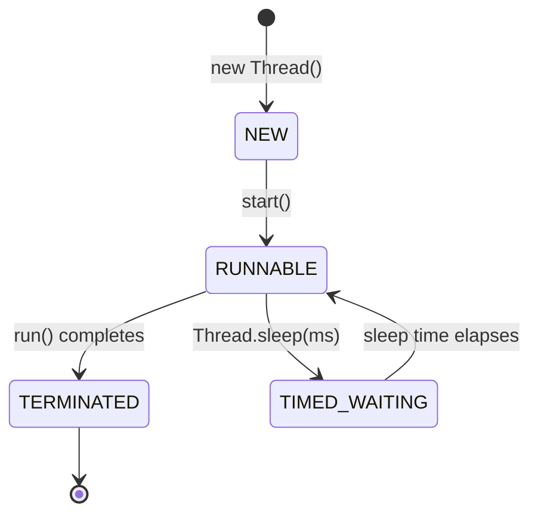

# Multithreading in Java

A structured, hands-on repository documenting my journey learning **Java Multithreading & Concurrency**, from thread creation and lifecycle fundamentals to advanced synchronization and concurrency utilities.

---

## 📁 Repository Structure

Each topic is organized into its own numbered directory so new lessons and examples can be added cleanly without overriding previous files:

```text
Multithreading-JAVA/
├── .gitignore
├── README.md
└── 01-thread-creation-and-lifecycle/
    ├── Demo.java    # Creating a thread by extending the Thread class
    ├── Demo2.java   # Creating a thread using Runnable & Lambda expressions
    ├── Demo3.java   # Inspecting Thread Name and Thread ID
    ├── Demo4.java   # start() vs run() & why a thread cannot be started twice
    ├── Demo5.java   # Concurrent execution & non-determinism (Even/Odd)
    └── Demo6.java   # Thread Lifecycle states (NEW, RUNNABLE, TERMINATED)
```

---

## 📚 Topics Covered

### 01. Thread Creation and Lifecycle
Directory: [`01-thread-creation-and-lifecycle/`](./01-thread-creation-and-lifecycle)

| File | Concept | Key Takeaways |
| :--- | :--- | :--- |
| [`Demo.java`](./01-thread-creation-and-lifecycle/Demo.java) | **Extending `Thread` Class** | Subclassing `Thread` and overriding `run()`. Calling `t1.start()` asks the JVM/OS to allocate a new thread with its own **Stack** and **Program Counter (PC)** before executing `run()`. |
| [`Demo2.java`](./01-thread-creation-and-lifecycle/Demo2.java) | **`Runnable` Interface & Lambdas** | Implementing `Runnable` (decoupling task from thread) and passing a **lambda expression** directly to `new Thread(...)` for cleaner, modern Java code. |
| [`Demo3.java`](./01-thread-creation-and-lifecycle/Demo3.java) | **Thread Name & ID** | Using `Thread.currentThread().getName()` and `Thread.currentThread().getId()` to identify the `main` thread and worker threads (`Thread-0`, `Thread-1`, etc.). |
| [`Demo4.java`](./01-thread-creation-and-lifecycle/Demo4.java) | **`start()` vs `run()`** | Calling `t1.start()` spawns a new thread; calling `t1.run()` directly executes synchronously on the `main` thread without creating a new thread. A thread **cannot** be started twice (throws `IllegalThreadStateException`). |
| [`Demo5.java`](./01-thread-creation-and-lifecycle/Demo5.java) | **Non-Deterministic Execution** | Running two threads concurrently (`T1` printing even numbers `0–100`, `T2` printing odd numbers `0–100`). Output order is controlled by the OS thread scheduler and varies across runs. |
| [`Demo6.java`](./01-thread-creation-and-lifecycle/Demo6.java) | **Thread Lifecycle (`Thread.State`)** | Observing `NEW` (created, not started), `RUNNABLE` (after `start()`), and `TERMINATED` (after `run()` completes, observed after `Thread.sleep(2000)`). |

#### Java Thread Lifecycle Overview



---

## 🚀 How to Compile and Run

Make sure you have **Java (JDK 8 or higher)** installed.

1. Navigate to the topic directory:
   ```bash
   cd 01-thread-creation-and-lifecycle
   ```

2. Compile all `.java` files:
   ```bash
   javac *.java
   ```

3. Run any demo:
   ```bash
   java Demo
   java Demo2
   java Demo3
   java Demo4
   java Demo5
   java Demo6
   ```

> **Note:** Compiled `.class` files are automatically ignored by `.gitignore` to keep the repository clean.

---

## 🗺️ Learning Roadmap

- [x] **01. Thread Creation and Lifecycle** (`Thread`, `Runnable`, Lambdas, `start()` vs `run()`, `Thread.State`)
- [ ] **02. Thread Methods & Control** (`sleep`, `join`, `yield`, `interrupt`, Daemon threads)
- [ ] **03. Synchronization & Race Conditions** (`synchronized`, intrinsic locks, `volatile`)
- [ ] **04. Inter-Thread Communication** (`wait`, `notify`, `notifyAll`, Producer-Consumer)
- [ ] **05. Locks & Concurrency Utilities** (`ReentrantLock`, `Semaphore`, `CountDownLatch`)
- [ ] **06. Executor Framework & `CompletableFuture`** (Thread pools, `Callable`, `Future`)
