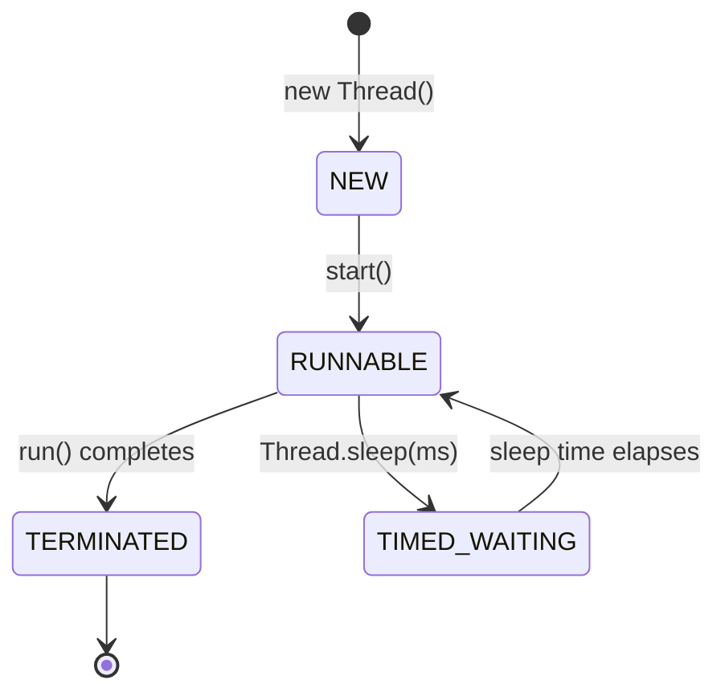

# Multithreading in Java

A structured, hands-on repository documenting my journey learning **Java Multithreading & Concurrency**, from thread creation and lifecycle fundamentals to advanced synchronization and concurrency utilities.

---

## 📁 Repository Structure

Each topic is organized into its own numbered directory so new lessons and examples can be added cleanly without overriding previous files:

```text
java-multithreading-journey/
├── .gitignore
├── README.md
├── 01-thread-creation-and-lifecycle/
│   ├── Demo.java    # Creating a thread by extending the Thread class
│   ├── Demo2.java   # Creating a thread using Runnable & Lambda expressions
│   ├── Demo3.java   # Inspecting Thread Name and Thread ID
│   ├── Demo4.java   # start() vs run() & why a thread cannot be started twice
│   ├── Demo5.java   # Concurrent execution & non-determinism (Even/Odd)
│   └── Demo6.java   # Thread Lifecycle states (NEW, RUNNABLE, TERMINATED)
├── 02-thread-methods/
│   ├── Demo.java    # Thread.sleep() and TIMED_WAITING state
│   ├── Demo2.java   # Thread.join() and timed join(ms)
│   ├── Demo3.java   # Thread.yield() scheduler hint
│   ├── Demo4.java   # Thread.interrupt(), interrupted(), and isInterrupted()
│   ├── Demo5.java   # Checking thread liveness with isAlive()
│   ├── Demo6.java   # Customizing thread names with setName() & currentThread()
│   ├── Demo7.java   # Thread priorities (MIN_PRIORITY, NORM_PRIORITY, MAX_PRIORITY)
│   └── Demo8.java   # Daemon threads with setDaemon(true)
├── 03-problems-in-multithreading/
│   ├── Demo.java    # Race condition & critical section (non-atomic count++)
│   └── Demo2.java   # Visibility problem & volatile flag across threads
└── 04-monitor-locks/
    ├── Demo.java    # Fixing race condition with synchronized(this) block
    ├── Demo2.java   # Synchronized instance method acquiring object monitor
    ├── Demo3.java   # Multiple synchronized methods sharing the same object lock
    ├── Demo4.java   # Custom lock objects & the new Object() pitfall
    ├── Demo5.java   # Static synchronization using ClassName.class monitor
    └── Demo6.java   # Object monitor (this) vs Class monitor (ClassName.class)
```

---

## 📚 Topics Covered

### 01. Thread Creation and Lifecycle
Directory: [`01-thread-creation-and-lifecycle/`](./01-thread-creation-and-lifecycle)

| File | Concept | Key Takeaways |
| :--- | :--- | :--- |
| [`Demo.java`](./01-thread-creation-and-lifecycle/Demo.java) | **Extending `Thread` Class** | Subclassing `Thread` and overriding `run()`. Calling `t1.start()` asks the JVM/OS to allocate a new thread with its own **Stack** and **Program Counter (PC)** before executing `run()`. |
| [`Demo2.java`](./01-thread-creation-and-lifecycle/Demo2.java) | **`Runnable` Interface & Lambdas** | Implementing `Runnable` (decoupling task from thread) and passing a **lambda expression** directly to `new Thread(...)` for cleaner, modern Java code. |
| [`Demo3.java`](./01-thread-creation-and-lifecycle/Demo3.java) | **Thread Name & ID** | Using `Thread.currentThread().getName()` and `Thread.currentThread().getId()` to identify the `main` thread and worker threads (`Thread-0`, `Thread-1`, etc.). |
| [`Demo4.java`](./01-thread-creation-and-lifecycle/Demo4.java) | **`start()` vs `run()`** | Calling `t1.start()` spawns a new thread; calling `t1.run()` directly executes synchronously on the `main` thread without creating a new thread. A thread **cannot** be started twice (throws `IllegalThreadStateException`). |
| [`Demo5.java`](./01-thread-creation-and-lifecycle/Demo5.java) | **Non-Deterministic Execution** | Running two threads concurrently (`T1` printing even numbers `0–100`, `T2` printing odd numbers `0–100`). Output order is controlled by the OS thread scheduler and varies across runs. |
| [`Demo6.java`](./01-thread-creation-and-lifecycle/Demo6.java) | **Thread Lifecycle (`Thread.State`)** | Observing `NEW` (created, not started), `RUNNABLE` (after `start()`), and `TERMINATED` (after `run()` completes, observed after `Thread.sleep(2000)`). |

#### Java Thread Lifecycle Overview



---

### 02. Thread Methods & Control
Directory: [`02-thread-methods/`](./02-thread-methods)

| File | Concept | Key Takeaways |
| :--- | :--- | :--- |
| [`Demo.java`](./02-thread-methods/Demo.java) | **`Thread.sleep(ms)`** | Pauses the current thread for a specified duration, transitioning it from `RUNNABLE` to `TIMED_WAITING` and back to `RUNNABLE`. |
| [`Demo2.java`](./02-thread-methods/Demo2.java) | **`join()` & `join(ms)`** | Makes the calling thread (`main`) wait (`WAITING` / `TIMED_WAITING`) until the target thread (`t1`) finishes or the timeout elapses. |
| [`Demo3.java`](./02-thread-methods/Demo3.java) | **`Thread.yield()`** | Hints to the OS thread scheduler that the current thread is willing to yield CPU time to another `RUNNABLE` thread of the same priority (OS may ignore it; thread stays `RUNNABLE`). |
| [`Demo4.java`](./02-thread-methods/Demo4.java) | **`interrupt()` & `interrupted()`** | Signals a thread to stop gracefully via its interrupt flag. `isInterrupted()` checks the flag; `interrupted()` checks and resets it to `false`. Calling `interrupt()` during `sleep()`/`join()`/`wait()` throws `InterruptedException`. |
| [`Demo5.java`](./02-thread-methods/Demo5.java) | **`isAlive()`** | Checks whether a thread has started and not yet terminated (`false` before `start()`, `true` while running/sleeping, `false` after completion). |
| [`Demo6.java`](./02-thread-methods/Demo6.java) | **`setName()` & `currentThread()`** | Assigns a custom name (e.g., `"worker-1"`) with `setName()` and retrieves the executing thread reference via `Thread.currentThread()`. |
| [`Demo7.java`](./02-thread-methods/Demo7.java) | **Thread Priorities** | Uses `setPriority()` / `getPriority()` (`MIN_PRIORITY = 1`, `NORM_PRIORITY = 5`, `MAX_PRIORITY = 10`). Scheduling behavior depends on the OS. |
| [`Demo8.java`](./02-thread-methods/Demo8.java) | **Daemon Threads** | Marks a background thread with `setDaemon(true)` before `start()`. Daemon threads (like Garbage Collection) terminate automatically once all user threads (`main`) finish. |

---

### 03. Problems in Multithreading
Directory: [`03-problems-in-multithreading/`](./03-problems-in-multithreading)

| File | Concept | Key Takeaways |
| :--- | :--- | :--- |
| [`Demo.java`](./03-problems-in-multithreading/Demo.java) | **Race Condition & Critical Section** | Two threads increment a shared `Counter` (`count++`) 10,000 times each. Because `count++` is a non-atomic read-modify-write sequence, thread interleaving causes lost updates (`count < 20000`). |
| [`Demo2.java`](./03-problems-in-multithreading/Demo2.java) | **Visibility & `volatile`** | Demonstrates how one thread updating `flag = true` may not be visible to another thread spinning in `while (!flag)` without a happens-before relationship—solved by declaring `flag` as `volatile`. |

#### Core Concurrency Problems & Guarantees
Concurrency bugs happen when **shared + mutable state** is accessed by multiple threads without coordination:
- **Atomicity** *(Can another thread interfere halfway?)*: Operations like `count++`, `x += 5`, and check-then-act (`if (balance >= amount) balance -= amount;`) are multi-step and can be interleaved. Fix with `synchronized`, `AtomicInteger`, or `ReentrantLock`.
- **Visibility** *(Can another thread see the latest write?)*: Without a **happens-before** relationship, CPU registers/caches and compiler optimizations can hide updates from other threads. Fix with `volatile` (for simple state flags) or `synchronized`.
- **Ordering** *(In what order do writes become observable?)*: Compilers/CPUs can reorder instructions as long as single-threaded semantics hold. `volatile` and `synchronized` establish safe publication ordering.

| Problem | Main Meaning | Typical Example | Fix / Mechanism |
| :--- | :--- | :--- | :--- |
| **Race Condition** | Result depends on thread timing/order | Two threads incrementing `count++` | `synchronized`, `AtomicInteger`, `Lock` |
| **Atomicity Problem** | Multi-step operation is interleaved | `count++` or check-then-act | `synchronized`, `Atomic*`, `ReentrantLock` |
| **Visibility Problem** | Thread does not observe another's write | Non-volatile stop `flag` | `volatile`, `synchronized` |
| **Ordering Problem** | Writes observed out of expected order | `ready = true` seen before `data = 10` | `volatile` (safe publication), `synchronized` |
| **Thread Interference** | Overlapping ops disrupt each other | Lost update on shared counter | Mutual exclusion (`synchronized`, `Lock`) |
| **Data Inconsistency** | Program state violates expected rules | Stale/partial read, lost update | Immutability, thread confinement, proper locking |

---

### 04. Synchronization & Monitor Locks
Directory: [`04-monitor-locks/`](./04-monitor-locks)

| File | Concept | Key Takeaways |
| :--- | :--- | :--- |
| [`Demo.java`](./04-monitor-locks/Demo.java) | **`synchronized(this)` Block** | Protects only the critical section (`count++`) with the current object's monitor, eliminating lost updates so two threads produce `20000`. |
| [`Demo2.java`](./04-monitor-locks/Demo2.java) | **Synchronized Instance Method** | `synchronized void show()` acquires the monitor of `this`; two threads calling `show()` on the same `Test` instance execute mutually exclusively. |
| [`Demo3.java`](./04-monitor-locks/Demo3.java) | **Lock Belongs to Object, Not Method** | Two different `synchronized` methods (`m1()` and `m2()`) on the same `Test1` object share the same `this` monitor, so one blocks the other. |
| [`Demo4.java`](./04-monitor-locks/Demo4.java) | **Custom Locks & `new Object()` Pitfall** | Demonstrates dedicated lock objects (`lock1`, `lock2`) for independent operations (`deposit`/`withdraw`), and highlights why `synchronized(new Object())` fails (each thread gets a different monitor). |
| [`Demo5.java`](./04-monitor-locks/Demo5.java) | **Static Synchronization** | `synchronized static void increment()` acquires the class-level monitor (`Counter1.class`), protecting static state across all instances. |
| [`Demo6.java`](./04-monitor-locks/Demo6.java) | **Object Monitor vs Class Monitor** | A static synchronized method (`Class` monitor) and an instance synchronized method (`this` monitor) use different locks and can execute concurrently. |

#### Monitor Lock Cheat Sheet
- **Synchronized Instance Method / `synchronized(this)`** → acquires the monitor of the current instance (`this`).
- **Synchronized Static Method / `synchronized(ClassName.class)`** → acquires the monitor of the `Class` object.
- **Custom Lock (`private final Object lock = new Object()`)** → isolates locking to specific independent state and prevents external code from locking on `this`.
- **Key Properties:** Monitors provide both **mutual exclusion** and **memory visibility** (happens-before on unlock → lock), are **reentrant**, and are **automatically released** when exiting the block (even on exceptions).

---

## 🚀 How to Compile and Run

Make sure you have **Java (JDK 8 or higher)** installed.

1. Navigate to a topic directory (for example, `01-thread-creation-and-lifecycle`, `02-thread-methods`, `03-problems-in-multithreading`, or `04-monitor-locks`):
   ```bash
   cd 04-monitor-locks
   ```

2. Compile all `.java` files:
   ```bash
   javac *.java
   ```

3. Run any demo:
   ```bash
   java Demo
   java Demo2
   # ... up to Demo6
   ```

> **Note:** Compiled `.class` files are automatically ignored by `.gitignore` to keep the repository clean.

---

## 🗺️ Learning Roadmap

- [x] **01. Thread Creation and Lifecycle** (`Thread`, `Runnable`, Lambdas, `start()` vs `run()`, `Thread.State`)
- [x] **02. Thread Methods & Control** (`sleep`, `join`, `yield`, `interrupt`, `isAlive`, `setName`, Priority, Daemon threads)
- [x] **03. Problems in Multithreading** (Race conditions, Critical section, Atomicity, Visibility, Ordering, `volatile`)
- [x] **04. Synchronization & Monitor Locks** (`synchronized` methods/blocks, `this` vs `Class` monitor, custom locks, reentrancy)
- [ ] **05. Inter-Thread Communication** (`wait`, `notify`, `notifyAll`, Producer-Consumer)
- [ ] **06. Concurrency Utilities & Executors** (`ReentrantLock`, `AtomicInteger`, `Semaphore`, `CountDownLatch`, Thread pools, `CompletableFuture`)
