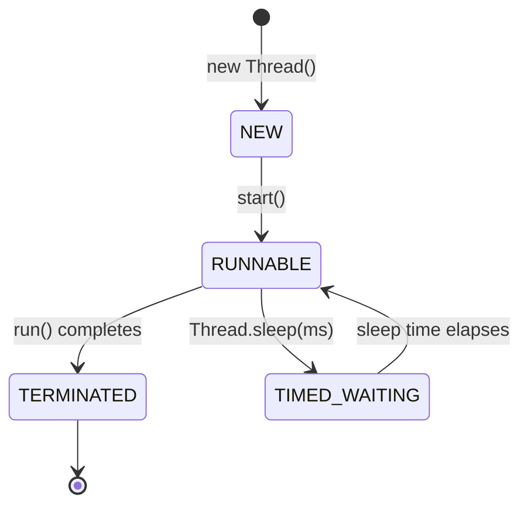

# Multithreading in Java

A structured, hands-on repository documenting my journey learning **Java Multithreading & Concurrency**, from thread creation and lifecycle fundamentals to advanced synchronization and concurrency utilities.

---

## 📁 Repository Structure

Each topic is organized into its own numbered directory so new lessons and examples can be added cleanly without overriding previous files:

```text
java-multithreading-journey/
├── .gitignore
├── README.md
├── 01-thread-creation-and-lifecycle/
│   ├── Demo.java    # Creating a thread by extending the Thread class
│   ├── Demo2.java   # Creating a thread using Runnable & Lambda expressions
│   ├── Demo3.java   # Inspecting Thread Name and Thread ID
│   ├── Demo4.java   # start() vs run() & why a thread cannot be started twice
│   ├── Demo5.java   # Concurrent execution & non-determinism (Even/Odd)
│   └── Demo6.java   # Thread Lifecycle states (NEW, RUNNABLE, TERMINATED)
└── 02-thread-methods/
    ├── Demo.java    # Thread.sleep() and TIMED_WAITING state
    ├── Demo2.java   # Thread.join() and timed join(ms)
    ├── Demo3.java   # Thread.yield() scheduler hint
    ├── Demo4.java   # Thread.interrupt(), interrupted(), and isInterrupted()
    ├── Demo5.java   # Checking thread liveness with isAlive()
    ├── Demo6.java   # Customizing thread names with setName() & currentThread()
    ├── Demo7.java   # Thread priorities (MIN_PRIORITY, NORM_PRIORITY, MAX_PRIORITY)
    └── Demo8.java   # Daemon threads with setDaemon(true)
```

---

## 📚 Topics Covered

### 01. Thread Creation and Lifecycle
Directory: [`01-thread-creation-and-lifecycle/`](./01-thread-creation-and-lifecycle)

| File | Concept | Key Takeaways |
| :--- | :--- | :--- |
| [`Demo.java`](./01-thread-creation-and-lifecycle/Demo.java) | **Extending `Thread` Class** | Subclassing `Thread` and overriding `run()`. Calling `t1.start()` asks the JVM/OS to allocate a new thread with its own **Stack** and **Program Counter (PC)** before executing `run()`. |
| [`Demo2.java`](./01-thread-creation-and-lifecycle/Demo2.java) | **`Runnable` Interface & Lambdas** | Implementing `Runnable` (decoupling task from thread) and passing a **lambda expression** directly to `new Thread(...)` for cleaner, modern Java code. |
| [`Demo3.java`](./01-thread-creation-and-lifecycle/Demo3.java) | **Thread Name & ID** | Using `Thread.currentThread().getName()` and `Thread.currentThread().getId()` to identify the `main` thread and worker threads (`Thread-0`, `Thread-1`, etc.). |
| [`Demo4.java`](./01-thread-creation-and-lifecycle/Demo4.java) | **`start()` vs `run()`** | Calling `t1.start()` spawns a new thread; calling `t1.run()` directly executes synchronously on the `main` thread without creating a new thread. A thread **cannot** be started twice (throws `IllegalThreadStateException`). |
| [`Demo5.java`](./01-thread-creation-and-lifecycle/Demo5.java) | **Non-Deterministic Execution** | Running two threads concurrently (`T1` printing even numbers `0–100`, `T2` printing odd numbers `0–100`). Output order is controlled by the OS thread scheduler and varies across runs. |
| [`Demo6.java`](./01-thread-creation-and-lifecycle/Demo6.java) | **Thread Lifecycle (`Thread.State`)** | Observing `NEW` (created, not started), `RUNNABLE` (after `start()`), and `TERMINATED` (after `run()` completes, observed after `Thread.sleep(2000)`). |

#### Java Thread Lifecycle Overview



---

### 02. Thread Methods & Control
Directory: [`02-thread-methods/`](./02-thread-methods)

| File | Concept | Key Takeaways |
| :--- | :--- | :--- |
| [`Demo.java`](./02-thread-methods/Demo.java) | **`Thread.sleep(ms)`** | Pauses the current thread for a specified duration, transitioning it from `RUNNABLE` to `TIMED_WAITING` and back to `RUNNABLE`. |
| [`Demo2.java`](./02-thread-methods/Demo2.java) | **`join()` & `join(ms)`** | Makes the calling thread (`main`) wait (`WAITING` / `TIMED_WAITING`) until the target thread (`t1`) finishes or the timeout elapses. |
| [`Demo3.java`](./02-thread-methods/Demo3.java) | **`Thread.yield()`** | Hints to the OS thread scheduler that the current thread is willing to yield CPU time to another `RUNNABLE` thread of the same priority (OS may ignore it; thread stays `RUNNABLE`). |
| [`Demo4.java`](./02-thread-methods/Demo4.java) | **`interrupt()` & `interrupted()`** | Signals a thread to stop gracefully via its interrupt flag. `isInterrupted()` checks the flag; `interrupted()` checks and resets it to `false`. Calling `interrupt()` during `sleep()`/`join()`/`wait()` throws `InterruptedException`. |
| [`Demo5.java`](./02-thread-methods/Demo5.java) | **`isAlive()`** | Checks whether a thread has started and not yet terminated (`false` before `start()`, `true` while running/sleeping, `false` after completion). |
| [`Demo6.java`](./02-thread-methods/Demo6.java) | **`setName()` & `currentThread()`** | Assigns a custom name (e.g., `"worker-1"`) with `setName()` and retrieves the executing thread reference via `Thread.currentThread()`. |
| [`Demo7.java`](./02-thread-methods/Demo7.java) | **Thread Priorities** | Uses `setPriority()` / `getPriority()` (`MIN_PRIORITY = 1`, `NORM_PRIORITY = 5`, `MAX_PRIORITY = 10`). Scheduling behavior depends on the OS. |
| [`Demo8.java`](./02-thread-methods/Demo8.java) | **Daemon Threads** | Marks a background thread with `setDaemon(true)` before `start()`. Daemon threads (like Garbage Collection) terminate automatically once all user threads (`main`) finish. |

---

## 🚀 How to Compile and Run

Make sure you have **Java (JDK 8 or higher)** installed.

1. Navigate to a topic directory (for example, `01-thread-creation-and-lifecycle` or `02-thread-methods`):
   ```bash
   cd 02-thread-methods
   ```

2. Compile all `.java` files:
   ```bash
   javac *.java
   ```

3. Run any demo:
   ```bash
   java Demo
   java Demo2
   # ... up to Demo8
   ```

> **Note:** Compiled `.class` files are automatically ignored by `.gitignore` to keep the repository clean.

---

## 🗺️ Learning Roadmap

- [x] **01. Thread Creation and Lifecycle** (`Thread`, `Runnable`, Lambdas, `start()` vs `run()`, `Thread.State`)
- [x] **02. Thread Methods & Control** (`sleep`, `join`, `yield`, `interrupt`, `isAlive`, `setName`, Priority, Daemon threads)
- [ ] **03. Synchronization & Race Conditions** (`synchronized`, intrinsic locks, `volatile`)
- [ ] **04. Inter-Thread Communication** (`wait`, `notify`, `notifyAll`, Producer-Consumer)
- [ ] **05. Locks & Concurrency Utilities** (`ReentrantLock`, `Semaphore`, `CountDownLatch`)
- [ ] **06. Executor Framework & `CompletableFuture`** (Thread pools, `Callable`, `Future`)
